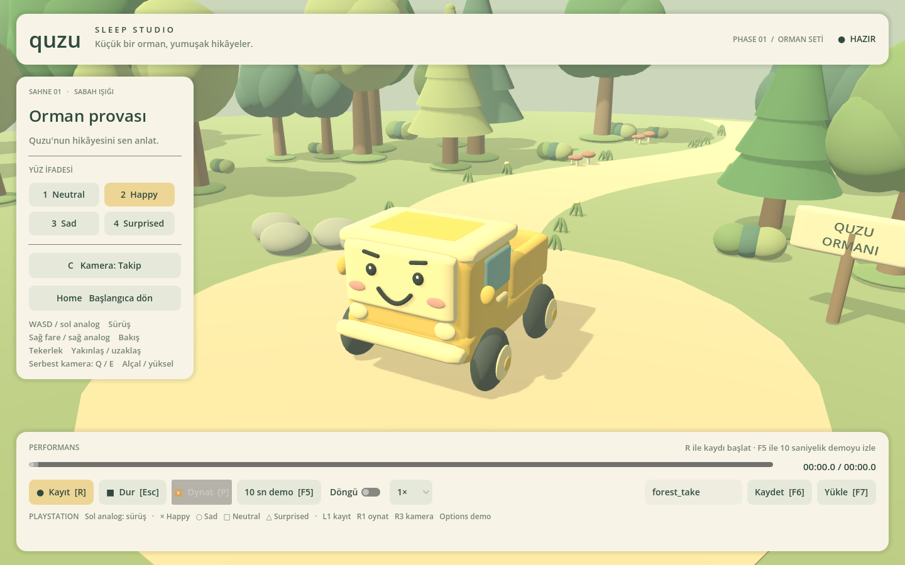

# Quzu Sleep Studio · Phase 1

Godot 4 ile hazırlanmış, oynanabilir küçük bir 3B animasyon stüdyosu. Pastel sarı Quzu kamyonunu ormanda sürün, yüz ifadelerini değiştirin ve performansını JSON olarak kaydedip yeniden oynatın.



## Çalıştırma

**Godot 4.6.3 Standard** ile geliştirilmiş ve test edilmiştir. .NET, Blender, harici model, eklenti veya paket kurulumu gerekmez. Compatibility/OpenGL 3.3 renderer kullanılır.

1. Depoyu indirin: `git clone --branch main https://github.com/Skvilla/qqq.git`
2. Godot Project Manager → **Import** → `qqq/project.godot`.
3. Projeyi açın ve **F5 / Run Project** düğmesine basın. Orman ve kamyon çalışma anında prosedürel olarak oluşturulur.

Terminalden:

```bash
cd qqq
godot --editor --path .   # Editörde aç
godot --path .            # Doğrudan oyna
godot --path . -- --demo  # Açılır açılmaz 10 sn performansı oynat
```

Çalıştırıcınızın adı `godot4` ise komutlarda `godot` yerine onu kullanın. Windows'ta `Godot_v4.6.3-stable_win64.exe --path .` eşdeğerdir.

## Phase 1 özellikleri

- Gerçek yuvarlatılmış mesh'lerle pastel sarı kamyon: dört dönen tekerlek, açık yük kasası, yan camlar, aynalar, farlar ve hareket sırasında hafif gövde salınımı.
- Neutral, Happy, Sad ve Surprised ifadeleri; gözler, kaşlar ve ağız geometrisi değişir.
- Tohum değeri sabit bir orman: kil görünümlü ağaçlar, çalılar, mantarlar, çiçekler, kayalar, kıvrımlı yol, tabela, ışık ve gölgeler.
- Fizik tabanlı sürüş: hızlanma, yavaşlama, geri gitme, fren, direksiyon ve gövde çarpışmaları. Sahnede dönüşü kolaylaştırmak için yerinde direksiyon da desteklenir.
- Yumuşak takip/orbit kamera, engel denetimi ve bağımsız serbest kamera.
- 60 Hz Record/Replay: konum, quaternion dönüşü ve yüz ifadesi; zaman çizgisinde gezinme, döngü, 0.5× / 1× / 1.5× oynatma.
- Sürümlü JSON kayıtları, dosyaya kaydetme/yükleme ve bozuk veri doğrulaması.
- Fareyle kullanılabilen Studio UI ve otomatik 10 saniyelik demo.

## Kontroller

| İşlem | Klavye / fare | PlayStation kontrolcüsü |
| --- | --- | --- |
| İleri / geri | W / S veya ↑ / ↓ | Sol analog yukarı / aşağı |
| Direksiyon | A / D veya ← / → | Sol analog sol / sağ |
| Fren | Space | L3 |
| Neutral | 1 | □ Kare |
| Happy | 2 | × Çarpı |
| Sad | 3 | ○ Daire |
| Surprised | 4 | △ Üçgen |
| Kaydı başlat / bitir | R | L1 |
| Baştan oynat | P | R1 |
| Durdur / fareyi bırak | Esc | Share / Create |
| Takip / serbest kamera | C | R3 |
| Kamerayı çevir | Sağ fare basılı + sürükle | Sağ analog |
| Takip kamerasını yakınlaştır | Fare tekerleği | UI dışındaki kamera bakışı sağ analogla |
| Serbest kamerayı taşı | WASD, Q aşağı / E yukarı | Sol analog, D-pad aşağı / yukarı |
| Serbest kamerayı hızlandır | Shift | — |
| Başlangıca dön | Home veya UI | UI |
| 10 sn demo | Oyun penceresinde F5 | Options |
| JSON kaydet / yükle | F6 / F7 veya UI | UI |

DualShock/DualSense, Godot'un standart joypad eşlemesini kullanır. Kontrolcüyü USB veya Bluetooth ile işletim sistemine bağlayın. Fiziksel PlayStation donanımı bu geliştirme ortamında bulunmadığı için USB/Bluetooth testi yapılmadı; standart joypad olayları otomatik test edildi. Birden fazla kontrolcü bağlıysa sağ analog kamera ilk cihazı kullanır.

Serbest kamerada sürüş girdileri kamerayı hareket ettirir; Quzu yerinde kalır. JSON dosya adı yazarken sürüş durur; **Enter** ile metin alanından çıkılır. Tekrar oynatmada karakter kontrolü kayda aittir, kamera bağımsız kullanılabilir.

## İlk kaydını oluştur

1. **R** ile kaydı başlatın.
2. **WASD** ile sürün; **1–4** ile ifadeleri değiştirin.
3. **R** veya **Esc** ile bitirin. **P** ile baştan izleyin.
4. Alttaki ad alanına `ilk_prova` yazıp Enter'a basın; **Kaydet / F6**.
5. **Home** ile Quzu'yu başlangıca alın; aynı kayıt adını girip **Yükle / F7**, ardından **P**.

Zaman çizgisi yüklenmiş kayıtta herhangi bir ana gider. Döngü anahtarı otomatik tekrarı açar. Yeni kayıt ve demo, bellekteki performansın yerini alır; saklamak istediğiniz performansı önce dosyaya kaydedin. Aynı dosya adı mevcut JSON'u atomik olarak yeniler.

Kayıtlar depo içine değil, Godot'un yazılabilir **`user://takes/`** klasörüne kaydedilir. Varsayılan dosya `forest_take.json`:

- Linux: `~/.local/share/godot/app_userdata/Quzu Sleep Studio/takes/`
- Windows: `%APPDATA%/Godot/app_userdata/Quzu Sleep Studio/takes/`
- macOS: `~/Library/Application Support/Godot/app_userdata/Quzu Sleep Studio/takes/`

Godot editöründe **Project → Open User Data Folder** ile de açılabilir. `XDG_DATA_HOME` tanımlı Linux ortamlarında kayıt yolu bu değişkene göre değişir. Kayıt adı güvenli bir dosya adına dönüştürülür; klasör geçişi kabul edilmez. Azami süre 10 dakika, yükleme sınırı 16 MB'dir.

## 10 saniyelik örnek performans

**F5**, **Options** veya **10 sn demo** düğmesi Quzu'yu açıklıkta yumuşakça başlayan ve biten bir yay üzerinde gezdirir. Her 2.5 saniyede bir ifade değişir: Neutral → Happy → Sad → Surprised. Toplam **601 örnek**, başlangıç ve bitiş dahil **tam 10 saniye**.

Demo ayrıca `user://takes/demo_10s.json` olarak kaydedilir. UI'da `demo_10s` adıyla yeniden yüklenebilir. Aynı performansın taşınabilir örneği [`examples/forest_demo.json`](examples/forest_demo.json) içinde bulunur; kendi `takes` klasörünüze kopyalayıp `forest_demo` adıyla yükleyebilirsiniz.

Görüntüsüz demo doğrulaması:

```bash
godot --headless --path . --fixed-fps 60 --quit-after 720 -- --demo --quit-after-demo
```

Başarılı çalışmada `DEMO_COMPLETE duration=10.000 samples=601 expression=Surprised` yazılır. `--fixed-fps` simülasyonu hızlandırır; görsel olarak gerçek sürede izlemek için normal `--demo` komutunu kullanın.

## Testler

```bash
bash tests/run_tests.sh
# Alternatif çalıştırıcı:
GODOT_BIN=godot4 bash tests/run_tests.sh
```

Betik Bash ve `rg` (ripgrep) kullanır. Testlerin kendisi yalnızca Godot'a bağımlıdır; Bash olmayan sistemlerde doğrudan çalıştırabilirsiniz:

```bash
godot --headless --path . --editor --import --quit
godot --headless --path . --fixed-fps 60 --script tests/test_phase1.gd
godot --headless --path . --fixed-fps 60 --script tests/test_regressions.gd
```

Ayrıntılı kabul senaryoları ve doğrulama sınırları: [`docs/TESTLER.md`](docs/TESTLER.md).

## Kaynak düzeni

| Dosya | Görev |
| --- | --- |
| `project.godot` | Ana sahne, renderer ve fizik ayarları |
| `scenes/studio.tscn` | Orman, kamyon ve kamera sahnesi |
| `scenes/truck.tscn` | CharacterBody3D ve çarpışma şekli |
| `scripts/clay.gd` | Yuvarlatılmış mesh ve kil malzeme yardımcıları |
| `scripts/truck.gd` | Prosedürel kamyon, sürüş ve ifadeler |
| `scripts/forest.gd` | Deterministik orman seti ve aydınlatma |
| `scripts/input_bindings.gd` | Klavye / PlayStation eylemleri |
| `scripts/studio_camera.gd` | Takip, orbit ve serbest kamera |
| `scripts/take_recorder.gd` | Kayıt, interpolasyon, JSON doğrulama ve demo |
| `scripts/studio_ui.gd`, `scripts/studio.gd` | Studio arayüzü ve özellik bağlantıları |
| `materials/` | Düzenlenebilir kil malzemeleri |
| `examples/forest_demo.json` | Gerçek 10 sn kayıt verisi |
| `tests/` | Godot entegrasyon testleri ve ekran görüntüsü aracı |

Kayıt formatı `quzu-take`, sürüm `1`'dir. `frames` içindeki `t` saniye, `p` dünya konumu `[x,y,z]`, `q` quaternion `[x,y,z,w]`, `expression` dört ifadeden biridir. Konum doğrusal, dönüş en kısa quaternion yayıyla interpolate edilir; ifade bir sonraki olayın zamanına kadar korunur. Fizik tekrar simüle edilmez; kayıtlı performans yeniden uygulanır. Kamera ve görsel tekerlek/gövde salınımı kayıt formatının parçası değildir.

Bu teslim yalnızca Phase 1'i kapsar. Ses, video dışa aktarma, kurgu/montaj ve sonraki fazlara ait sistemler eklenmemiştir.
